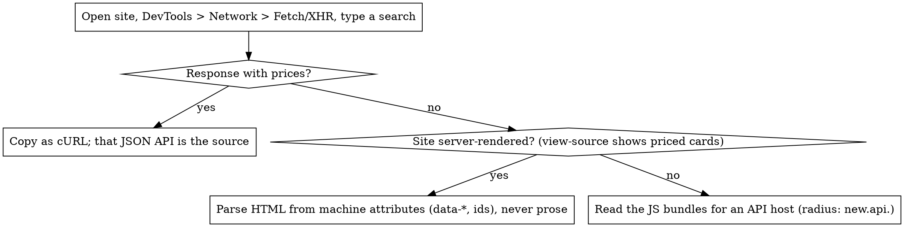

# Adding a source

## Overview

A source is one file implementing `Source` (`narxnoma/sources/base.py`),
one recorded fixture, one test module, one doc, and four registrations.
Everything the client claims must be asserted against the fixture; the doc
is written so the client could be rebuilt from it alone.

## 1. Find the durable path



Check `robots.txt` first. If it disallows the browse surface, you need
written permission from the site (see skill `fetch-glotr`) or you stop.

Prefer, in order: category/catalogue endpoint (olcha, beemarket) → broad
query walk (texnomart) → brand-query list (idea, alifshop, share
`brand_queries.py`) → search-only with `can_sweep = False` (mediapark).

## 2. Write the client

```python
# narxnoma/sources/<slug>.py
API_URL = "https://..."
PRODUCT_URL = "https://.../{id}"          # verified in a browser, not guessed

def _parse_item(item: dict) -> Listing | None:
    price = coerce_price(item.get("<the one current-price field>"))
    return try_build_listing(store_slug="<slug>", source_key=str(item["id"]),
                             name_raw=item["name"], price=price,
                             url=PRODUCT_URL.format(id=item["id"]),
                             image_url=item.get("image"), raw=item)

def parse(payload: dict) -> list[Listing]:     # pure function of one response
    ...

class <Slug>Source:
    slug = "<slug>"
    can_sweep = True
    def sweep(self, category="smartphones") -> Iterator[Listing]:  # uses base.paginate
    def search(self, query) -> Iterator[Listing]:
```

Invariants the base layer enforces or expects:

- `parse()` never filters by category; crawl policy lives in `sweep()`.
- Use `base.paginate(fetch, parse, next_page)`: retries one bad page, raises
  when a page fails outright, and only `next_page` ends the sweep — never
  an empty page.
- Multi-seller site: one listing per seller offer, `source_key` = offer id.
- Variant-level site (radius): one listing per variant, name from the variant.
- Price unit checked against the rendered page; `PRICE_MIN..PRICE_MAX` fence.
- GraphQL: inspect `errors` under HTTP 200.
- HTML: read the product id from two places and drop the card when they disagree.

## 3. Record a fixture and test

Save one real response to `tests/fixtures/sources/<slug>.json|html` (redact
nothing; it is public catalogue data). Tests in `tests/sources/test_<slug>.py`
assert, from the fixture: count parsed, one exact price and URL, the
end-of-pagination signal, and the trap you found. Add a `@pytest.mark.live`
case to `test_contract_live.py` asserting the endpoint shape.

## 4. Register

| where | what |
|---|---|
| `narxnoma/sources/__init__.py` | add to `SOURCES` |
| `narxnoma/pipeline/report.py` | `EXPECTED_MIN_OFFERS["<slug>"]` — measured floor; a source below it is flagged SUSPICIOUS |
| `narxnoma/db/schema.sql` | new migration inserting the `store` row (slug, name, url) |
| `narxnoma/matching/brands.py` | any new brands the source introduces |
| `docs/parsers/<slug>.md` + `README.md` table | canonical notes |
| `skills/fetch-<slug>/SKILL.md` | operational card |

## 5. Measure before calling it done

Run `python -m narxnoma.cli fetch --source <slug>`, open three built URLs
in a browser, compare three prices to the page. Then, with Postgres,
`cycle` and read the coverage report: the number that matters is how many
products got a **second** price, not how many rows arrived (radius: 2.2% of
offers, 4.8% of comparisons).

## Common mistakes

| Mistake | Fix |
|---|---|
| Stop paging on an empty page | Stop on the site's own pager / total count; empty pages are filtered pages |
| Build the slug yourself | Take it verbatim; open it |
| Trust `status_code` | GraphQL and some REST return 200 with an error body |
| One code path divides by 100, another does not | Single price coercion function per client |
| Doc written after the fact | Rebuild the client from the doc; if you cannot, the doc is incomplete |
